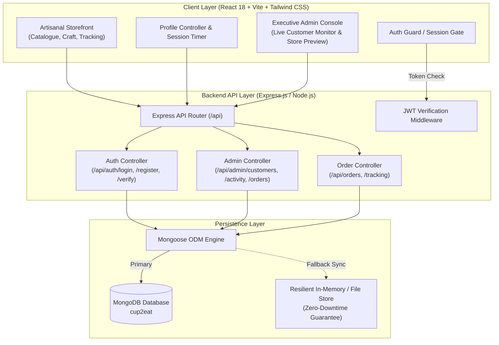

# ☕ Cup2Eat — Artisanal Edible Vessels & Sustainable Atelier

[](https://react.dev/)
[](https://vitejs.dev/)
[](https://tailwindcss.com/)
[](https://expressjs.com/)
[](https://www.mongodb.com/)
[](https://jwt.io/)
[](LICENSE)

> **Cup2Eat** is a full-stack, enterprise-grade e-commerce application and sustainable commerce platform. Handcrafted with an organic grain blend and enrobed in single-origin chocolate, each edible cup withstands hot espresso and specialty brews up to **85°C for 45 minutes** before transforming into a decadent treat—eliminating single-use paper cups entirely.
>
> Built with a high-performance **React 18 (Vite) + Tailwind CSS** storefront, an **Express.js + Node.js** backend, and a resilient **MongoDB (Mongoose)** persistence layer featuring real-time patron tracking, standalone executive administration, and full mobile/tablet responsiveness.

---

## 📑 Table of Contents

- [Architectural Highlights](#-architectural-highlights)
- [Key Features](#-key-features)
  - [1. Authentication & Security Gate](#1-strict-authentication--security-gate)
  - [2. Active Session Controller & Switcher](#2-active-session-controller--user-switcher)
  - [3. Standalone Executive Admin Panel](#3-standalone-executive-admin-panel)
  - [4. Artisanal Storefront & Cart Experience](#4-artisanal-storefront--cart-experience)
  - [5. Live Baking & BlueDart Order Tracking](#5-live-baking--bluedart-order-tracking)
  - [6. Complete Responsive Design](#6-complete-responsive-design-desktop--tablet--mobile)
- [System Architecture](#-system-architecture)
- [Tech Stack](#-tech-stack)
- [Live Demo Credentials](#-live-demo-credentials)
- [Project Directory Structure](#-project-directory-structure)
- [Getting Started](#-getting-started)
  - [Prerequisites](#prerequisites)
  - [Installation](#installation)
  - [Environment Configuration](#environment-configuration)
  - [Running the Application](#running-the-application)
- [REST API Reference](#-rest-api-reference)
- [MongoDB Data Models](#-mongodb-data-models)
- [Production Build](#-production-build)
- [License](#-license)

---

## 🌟 Architectural Highlights

- **Verified-Only Access Gate**: Storefront and patron services are strictly gated behind verified MongoDB account credentials; unauthenticated users are guided directly through the luxury authentication portal.
- **Hybrid Resilient Data Engine**: Employs Mongoose ODM connected to MongoDB with automatic fallback caching, guaranteeing zero downtime and complete functionality out-of-the-box.
- **Live Real-Time Online Monitoring**: Live socket/polling synchronization detects active sessions and displays glowing green presence badges on the Executive Admin Console as patrons browse.
- **Strict Role & Panel Isolation**: The Executive Admin Panel is decoupled from customer views—no admin switcher appears on consumer screens, preserving brand immersion.
- **True Adaptive Layouts**: Fully customized viewport layouts optimized for Desktop, Tablet (iPad portrait/landscape with collapsible sidebar), and Mobile screens.

---

## ✨ Key Features

### 1. Strict Authentication & Security Gate
- **Dual-Mode Luxury Portal**: Seamless toggle between **Sign In** and **Join the Atelier**.
- **Cryptographic Security**: Passwords hashed with `bcryptjs` (salt rounds: 10) and stateless sessions signed with `jsonwebtoken` (JWT).
- **Auto-Seeded Tasting Patrons**: Comes pre-populated with active customer and executive administrator profiles.
- **New Member Perks**: Automatic **200 Tasting Points** credit and eco-impact welcome bonus upon registration.

### 2. Active Session Controller & User Switcher
- **30-Minute Security Window**: Client-side countdown timer actively tracks session freshness.
- **One-Click Extension**: Patrons can click **Extend (+30m)** to refresh token longevity without disruption.
- **Seamless User Switching**: Direct **Switch to Other User** and **Logout** options embedded in desktop navbar, profile popover, mobile drawer, and admin header.
- **One-Click Profile Activation**: Direct navigation to personalized eco-impact statistics, saved vessels, delivery addresses, and artisanal subscription tiers.

### 3. Standalone Executive Admin Panel
- **Real-Time Customer Monitor**: Comprehensive patron directory displaying:
  - **Live Online Status**: Pulsing green indicator showing active logged-in patrons.
  - **Telemetry**: IP address, device footprint, last active timestamp, session count, and total lifetime spend.
- **Live Storefront Previewer ("See Whole Website")**:
  - Live preview viewport allowing administrators to inspect customer browsing.
  - Interactive viewport toggle (**Desktop 1440px** vs **Mobile 375px**).
  - Page switcher across *Catalogue*, *Our Craft*, and *Order Tracking*.
- **Atelier Oven Queue & Fulfillment**:
  - Track and advance orders through 6 fulfillment milestones (*Order Placed* → *Small-Batch Baking* → *Chocolate Enrobing* → *Quality Inspected* → *BlueDart Air Transit* → *Delivered*).
- **Executive Metrics Dashboard**: Real-time KPIs for Total Revenue, Single-Use Cups Diverted, Oven Batches, and Active Patrons.

### 4. Artisanal Storefront & Cart Experience
- **Interactive Flavor Catalog**: Madagascar Vanilla Waffle, Dark Belgian Chocolate Enrobed, Cardamom Spiced Crisp, and Himalayan Pink Salt Caramel.
- **Multi-Tier Pack Selector**: Dynamic pack sizing (6-Pack Sampler, 12-Pack Taster, 24-Pack Party, 48-Pack Café) with real-time price re-calculation and savings badges.
- **Slide-out Cart Basket Drawer**:
  - Dynamic free shipping progress meter (qualifies at ₹999).
  - Handcrafted gift packaging toggle with custom calligraphy card option.
  - Promo discount engine (e.g. `ARTISAN10` for 10% off).

### 5. Live Baking & BlueDart Order Tracking
- **Interactive Order Timeline**: Real-time 6-stage milestone tracker.
- **BlueDart AWB Integration**: Live airway bill copy action (`BD-99482014`) and carrier dispatch notes.
- **The 3-Step Cup2Eat Ritual**: Visual consumer guide for pouring, sipping, and savoring the vessel.

### 6. Complete Responsive Design (Desktop / Tablet / Mobile)
- **Desktop (>= 1024px)**: Full multi-column catalog, sticky cart drawer, and comprehensive metrics bar.
- **Tablet (768px - 1023px)**: Two-column grid, responsive drawer navigation, and adaptive touch-friendly cards.
- **Mobile (< 768px)**: Edge-to-edge layout, responsive bottom navigation sheet, touch-optimized quick-view modal, and floating basket launcher.

---

## 🏛 System Architecture



---

## 💻 Tech Stack

| Domain | Technology | Description |
| :--- | :--- | :--- |
| **Frontend Framework** | **React 18.2** | Component-driven UI architecture with hooks and context |
| **Build Tool** | **Vite 5.0** | Ultra-fast HMR and optimized Rollup production bundler |
| **Styling** | **Tailwind CSS 3.4** | Utility-first CSS with luxury serif & artisanal typography tokens |
| **Icons & Media** | **Lucide React** | Consistent, modern vector iconography |
| **Backend Runtime** | **Node.js + Express 4.19** | Scalable REST API with structured MVC routing |
| **Database** | **MongoDB & Mongoose 8.3** | Schema-enforced document storage with indexes and pre-save hooks |
| **Authentication** | **JWT & bcryptjs** | Stateless signed authentication with salted password hashing |
| **Environment** | **dotenv** | Configurable runtime environment management |

---

## 🔑 Live Demo Credentials

The platform is pre-loaded with demonstration accounts for instant verification:

### 👤 Connoisseur Customer Account
- **Email**: `aarav@connoisseur.in`
- **Password**: `password123`
- **Capabilities**: Browse catalog, customize packs, manage basket, place orders, track live BlueDart AWB, review eco impact (42 single-use cups saved).

### ⚡ Executive Administrator Account
- **Email**: `admin@cup2eat.in`
- **Password**: `admin123`
- **Capabilities**: Real-time customer activity monitor, live online pulse badges, oven baking queue management, and live website previewer (desktop & mobile).

---

## 📁 Project Directory Structure

```text
cup2eat_react/
├── .env.example             # Template for environment variables
├── .gitignore               # Excludes node_modules, dist, secrets, and temp logs
├── index.html               # Main HTML entry with Google Fonts (Playfair + Plus Jakarta)
├── package.json             # Scripts, frontend, and backend dependencies
├── postcss.config.js        # PostCSS pipeline for Tailwind CSS
├── tailwind.config.js       # Luxury theme colors (warm ivory, espresso, gold)
├── vite.config.js           # Vite development and proxy configuration
├── server/                  # Backend Express & MongoDB Architecture
│   ├── config/
│   │   └── db.js            # Mongoose connection with resilient fallback
│   ├── models/
│   │   ├── User.js          # Customer & Admin user schema with bcrypt hashing
│   │   ├── CustomerActivity.js # Audit log for logins, orders, and registrations
│   │   ├── Order.js         # Full order lifecycle and BlueDart AWB tracking
│   │   └── Product.js       # Small-batch product catalog specifications
│   ├── routes/
│   │   ├── authRoutes.js    # Sign-in, registration, session verification
│   │   ├── adminRoutes.js   # Customer directory, real-time presence, metrics
│   │   └── orderRoutes.js   # Order creation, status advancement, tracking
│   ├── services/
│   │   └── dataStore.js     # Dual-mode Mongoose & in-memory fallback sync
│   └── index.js             # Express application entry point (Port 5000)
└── src/                     # Frontend React Application
    ├── components/
    │   ├── CartDrawer.jsx       # Slide-out basket with shipping progress bar
    │   ├── Footer.jsx           # Artisanal footer with newsletter subscription
    │   ├── Navbar.jsx           # Responsive header, session countdown, profile menu
    │   ├── QuickViewModal.jsx   # Interactive product deep-dive modal
    │   └── ReceiptModal.jsx     # Order confirmation with tax breakdown
    ├── data/
    │   └── products.js          # Artisanal vessel data & flavor descriptions
    ├── pages/
    │   ├── AccountPage.jsx      # Patron dashboard, eco metrics & subscription
    │   ├── AdminPage.jsx        # Executive console, live monitor & store preview
    │   ├── AuthPage.jsx         # Verification gate, login & registration modal
    │   ├── CataloguePage.jsx    # Responsive grid, filters, and pack selectors
    │   ├── OrderTrackingPage.jsx # 6-stage milestone tracker & BlueDart carrier
    │   └── OurCraftPage.jsx     # Sustainable grain blend & thermal science story
    ├── services/
    │   └── api.js               # Centralized Axios/Fetch API client
    ├── App.jsx                  # Main application router and state coordinator
    ├── index.css                # Global stylesheet with custom animations
    └── main.jsx                 # React root DOM mount
```

---

## 🚀 Getting Started

### Prerequisites

- **Node.js**: v18.0.0 or higher ([Download Node.js](https://nodejs.org/))
- **npm**: v9.0.0 or higher
- **MongoDB**: Local MongoDB instance (`mongodb://localhost:27017`) or [MongoDB Atlas URI](https://www.mongodb.com/atlas)

### Installation

1. Clone the repository:
   ```bash
   git clone https://github.com/yash-newversion/CupProject.git
   cd CupProject
   ```

2. Install all dependencies:
   ```bash
   npm install
   ```

### Environment Configuration

Create a `.env` file in the project root (or copy `.env.example`):

```bash
cp .env.example .env
```

Ensure the configuration matches your local or cloud setup:

```env
PORT=5000
MONGODB_URI=mongodb://localhost:27017/cup2eat
JWT_SECRET=cup2eat_artisanal_secret_key_2026
```

### Running the Application

You can launch both the Express backend API and the Vite React frontend concurrently with a single command:

```bash
npm run dev
```

Alternatively, you can run them in separate terminal instances:

```bash
# Terminal 1: Launch Backend API (Port 5000)
npm run server

# Terminal 2: Launch Frontend Storefront (Port 3000)
npm run client
```

Open your browser and navigate to:
- **Frontend Storefront**: [http://localhost:3000](http://localhost:3000)
- **Backend API Health Check**: [http://localhost:5000/api/health](http://localhost:5000/api/health)

---

## 📡 REST API Reference

| Method | Endpoint | Description | Auth Required |
| :--- | :--- | :--- | :---: |
| `POST` | `/api/auth/register` | Register a new patron account (+200 welcome points) | No |
| `POST` | `/api/auth/login` | Authenticate customer/admin, issue signed JWT token | No |
| `GET` | `/api/auth/verify` | Validate session token & return active patron profile | Yes (JWT) |
| `POST` | `/api/auth/logout` | Terminate session and mark user offline | Yes (JWT) |
| `GET` | `/api/admin/customers` | Retrieve patron directory with live online presence | Yes (Admin) |
| `GET` | `/api/admin/activity` | Stream live customer audit events (logins, orders) | Yes (Admin) |
| `GET` | `/api/admin/stats` | Executive KPI dashboard metrics | Yes (Admin) |
| `GET` | `/api/orders` | Retrieve customer order history or all atelier orders | Yes (JWT) |
| `POST` | `/api/orders` | Create an artisanal order with selected pack variations | Yes (JWT) |
| `PATCH` | `/api/admin/orders/:id/status` | Advance order through the 6 baking milestones | Yes (Admin) |
| `GET` | `/api/products` | Retrieve small-batch catalog & heat resistance ratings | No |

---

## 🍃 MongoDB Data Models

### User Schema (`server/models/User.js`)
```javascript
{
  name: { type: String, required: true },
  email: { type: String, required: true, unique: true, lowercase: true },
  password: { type: String, required: true }, // bcrypt hashed
  role: { type: String, enum: ['customer', 'admin'], default: 'customer' },
  isOnline: { type: Boolean, default: false },
  lastLogin: { type: Date, default: Date.now },
  sessionCount: { type: Number, default: 0 },
  ecoMetrics: {
    cupsSaved: { type: Number, default: 0 },
    co2OffsetGrams: { type: Number, default: 0 },
    tastingPoints: { type: Number, default: 200 }
  },
  addresses: [{ street: String, city: String, pincode: String, isDefault: Boolean }]
}
```

### Order Schema (`server/models/Order.js`)
```javascript
{
  orderNumber: { type: String, unique: true },
  customer: { type: mongoose.Schema.Types.ObjectId, ref: 'User' },
  customerName: String,
  items: [{
    productId: String,
    name: String,
    packSize: Number, // 6, 12, 24, 48
    price: Number,
    quantity: Number
  }],
  totalAmount: Number,
  status: {
    type: String,
    enum: ['Order Placed', 'Baking in Atelier', 'Enrobed in Single-Origin Chocolate', 'Quality Inspected', 'Out for BlueDart Transit', 'Delivered'],
    default: 'Order Placed'
  },
  awbNumber: { type: String, default: 'BD-99482014' },
  createdAt: { type: Date, default: Date.now }
}
```

---

## 📦 Production Build

To test and compile the production-ready static assets:

```bash
npm run build
```

The optimized bundles will be generated in the `dist/` directory, ready to be deployed to any modern static hosting service (Vercel, Netlify, Cloudflare Pages, AWS S3) or served directly through Express.

---

## 📄 License

This project is licensed under the **MIT License**. See the [LICENSE](LICENSE) file for full details.

---

<p align="center">
  <b>Cup2Eat Atelier</b> &bull; Sip Your Brew. Eat Your Cup. &bull; Sustainable Luxury
</p>
